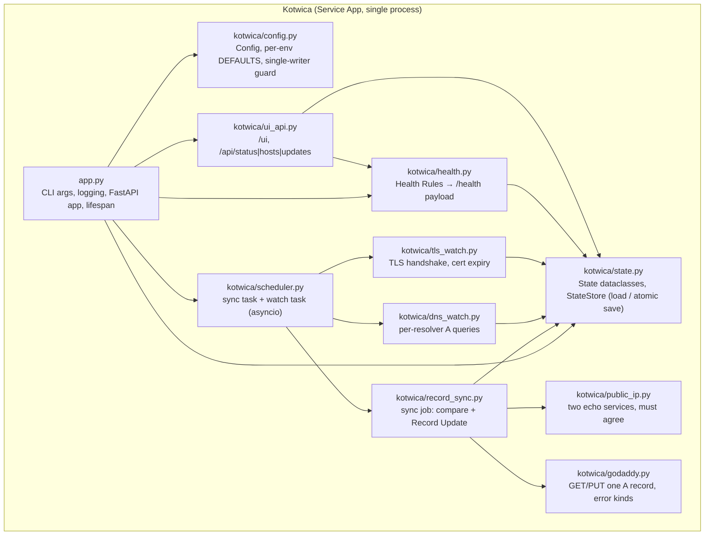
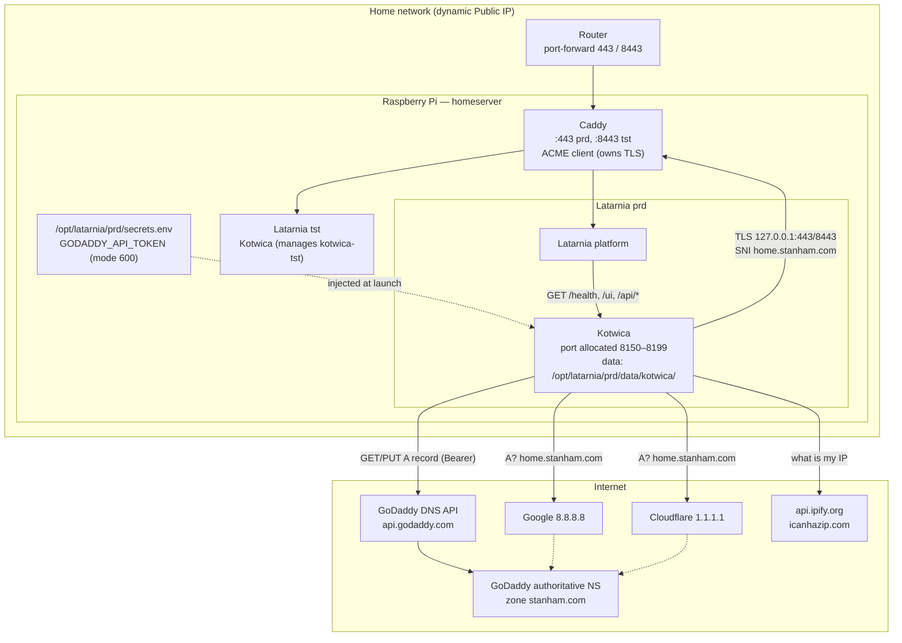
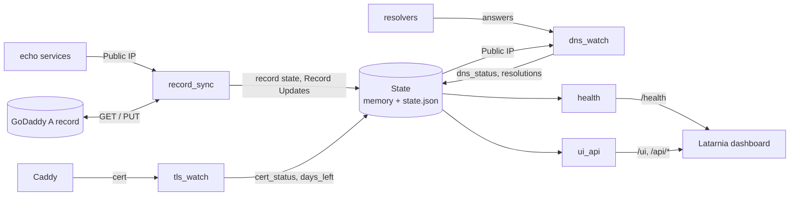

# P-0001 Architecture — Kotwica

## Component architecture

These module names are the implementation targets.



**Dependency rule:** only `app.py` wires concrete clients. `record_sync`, `dns_watch`, and `tls_watch` receive their clients (httpx client, resolver factory, TLS connect function) as arguments so tests can pass fakes. `health.py` is a pure function of `(State, Config, now)`.

## Repository layout

```
Kotwica/
├── latarnia.json          # Manifest (cap-001)
├── requirements.txt       # fastapi, uvicorn, httpx, dnspython, python-dotenv
├── app.py                 # entry point
├── kotwica/
│   ├── __init__.py
│   ├── config.py
│   ├── state.py
│   ├── scheduler.py
│   ├── public_ip.py
│   ├── godaddy.py
│   ├── record_sync.py
│   ├── dns_watch.py
│   ├── tls_watch.py
│   ├── health.py
│   └── ui_api.py
├── tests/                 # pytest; fakes for HTTP / DNS / TLS
├── .env                   # local dev only, gitignored
└── README.md              # operator notes
```

## Deployment topology



## External interactions

| System | Direction | Protocol | Used by | Failure handling |
|---|---|---|---|---|
| GoDaddy API `api.godaddy.com` | out | HTTPS, `Authorization: Bearer` | `godaddy.py` | 401/403 → `auth` (error); empty → `missing` (error); 429/5xx/timeout → `transient` (warning) |
| `api.ipify.org`, `icanhazip.com` | out | HTTPS GET, 5 s | `public_ip.py` | either fails or they disagree → Public IP unknown (warning) |
| `8.8.8.8`, `1.1.1.1` | out | DNS/UDP 53, direct, 5 s | `dns_watch.py` | timeout → `failed` for that resolver |
| Caddy on `127.0.0.1:443/8443` | local | TLS with SNI | `tls_watch.py` | verify error → `invalid`; refused/timeout → `unreachable` |
| Latarnia platform | in | HTTP on allocated port | `app.py`, `health.py`, `ui_api.py` | n/a |

## Data flow



## Environment matrix

| | dev (Mac) | tst (Pi) | prod (Pi) |
|---|---|---|---|
| Deployed | local `python app.py` | yes | yes |
| `ENV` source | `.env` / default | Latarnia `ENV=tst` | Latarnia `ENV=prd` → `prod` |
| Managed Record | `kotwica-dev.stanham.com` | `kotwica-tst.stanham.com` | `home.stanham.com` |
| TLS connect host | the hostname (public path) | `127.0.0.1` | `127.0.0.1` |
| Token source | `.env` `DEV_GODADDY_API_TOKEN` | Latarnia Secret `GODADDY_API_TOKEN` | Latarnia Secret `GODADDY_API_TOKEN` |
| Log level | DEBUG | WARNING | WARNING |
