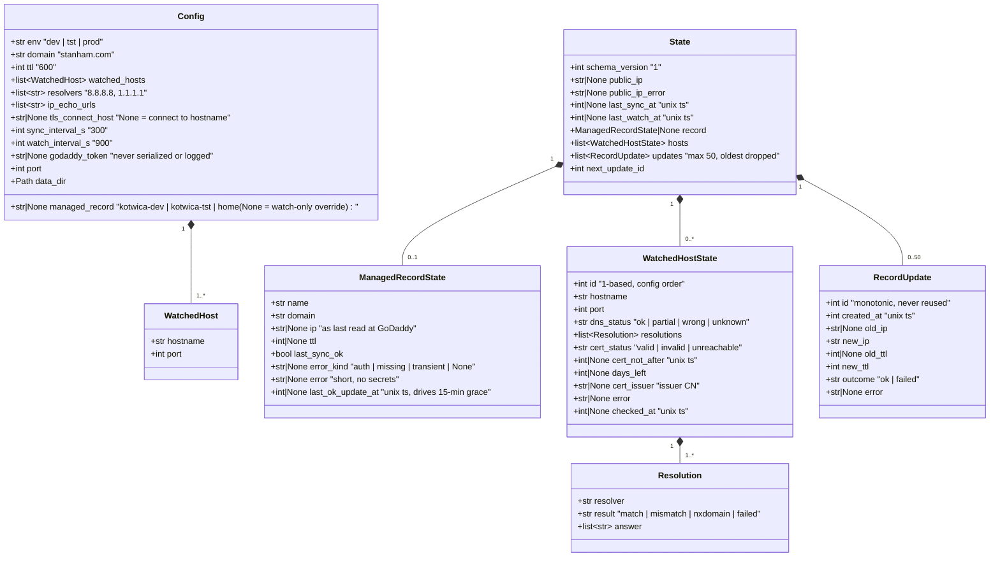

# P-0001 Data Model — Kotwica

Kotwica has no database. It has two data structures:

- **Config**: built at startup from the process env, `.env`, and committed defaults.
- **State**: persisted to `{data-dir}/state.json` with atomic writes.

The UI resources (cap-009) are projections of State.

## Config and State (classDiagram)



## Rules

- `State.hosts` is rebuilt from `Config.watched_hosts` on startup. Entries for hosts no longer configured are dropped. A host's `id` is its 1-based position in config order.
- `RecordUpdate.id` comes from `State.next_update_id`, which only ever increases, even after old entries are dropped at the 50-entry cap.
- `ManagedRecordState.last_ok_update_at` is set only when a PUT returns 2xx. It drives the 15-minute grace window in Health Rules 6 and 10.
- All timestamps are integer Unix seconds (UTC). This matches the Latarnia `date_*` convention directly.
- `godaddy_token` is excluded from any serialization of Config: no `__repr__`, no logging, never written to state.
- Unknown or invalid `state.json` → start with an empty State and log a WARNING (cap-003 `corrupt_state_recovers`).

## `state.json` example

```json
{
  "schema_version": 1,
  "public_ip": "167.60.249.130",
  "public_ip_error": null,
  "last_sync_at": 1791475200,
  "last_watch_at": 1791474900,
  "record": {
    "name": "home", "domain": "stanham.com",
    "ip": "167.60.249.130", "ttl": 600,
    "last_sync_ok": true, "error_kind": null, "error": null,
    "last_ok_update_at": 1791460000
  },
  "hosts": [
    {
      "id": 1, "hostname": "home.stanham.com", "port": 443,
      "dns_status": "ok",
      "resolutions": [
        {"resolver": "8.8.8.8", "result": "match", "answer": ["167.60.249.130"]},
        {"resolver": "1.1.1.1", "result": "match", "answer": ["167.60.249.130"]}
      ],
      "cert_status": "valid", "cert_not_after": 1799200000, "days_left": 89,
      "cert_issuer": "E6", "error": null, "checked_at": 1791474900
    }
  ],
  "updates": [
    {"id": 1, "created_at": 1791460000, "old_ip": "167.60.249.130", "new_ip": "167.60.249.130",
     "old_ttl": 3600, "new_ttl": 600, "outcome": "ok", "error": null}
  ],
  "next_update_id": 2
}
```

## UI resource projections (cap-009)

| Resource | Source | Field mapping |
|---|---|---|
| `status` (single item, `id: 1`) | `State` + `health.evaluate()` | `health`, `message`, `public_ip`, `record_name` (`{name}.{domain}` or `null`), `record_ip`, `record_ttl`, `date_last_sync` ← `last_sync_at`, `date_last_watch` ← `last_watch_at`, `last_error` ← `record.error` or `public_ip_error` |
| `hosts` | `State.hosts` | `id`, `name` = `host:port`, `dns_status`, `cert_status`, `days_left`, `date_cert_expires` ← `cert_not_after`, `date_checked` ← `checked_at`, `cert_issuer`, `last_error` ← `error`, `resolutions` |
| `updates` | `State.updates`, newest first | `id`, `date_created` ← `created_at`, `old_ip`, `new_ip`, `old_ttl`, `new_ttl`, `outcome`, `error` |
