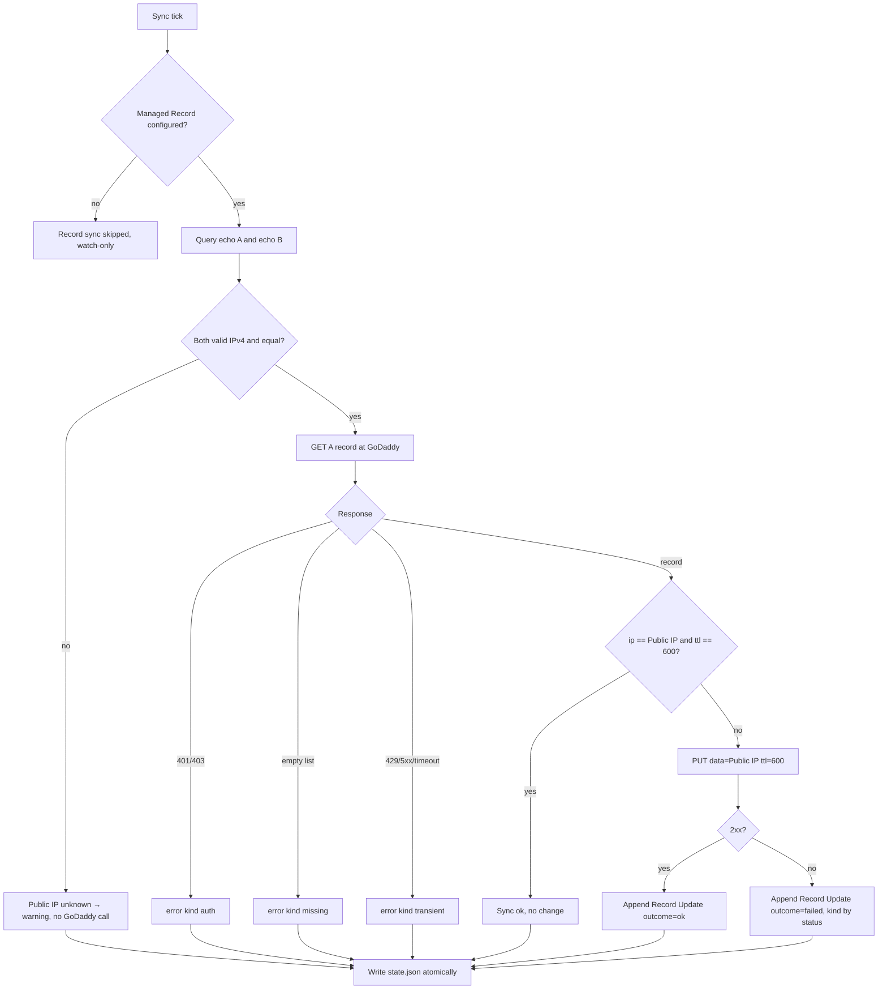
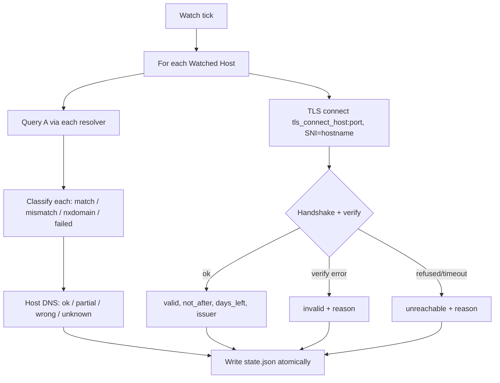
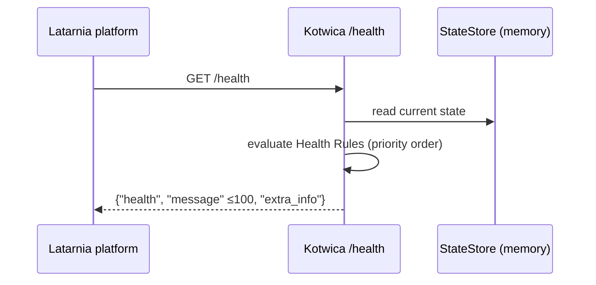

# P-0001 Spec — Kotwica: Home DDNS + Cert Watch

Origin pitch: [I-0001](../../Pitches/I-0001.md)

---

# Problem

- `home.stanham.com` is the public name for both Latarnia environments on the Raspberry Pi (tst on :8443, prd on :443). It depended on a TP-Link DDNS name whose authoritative servers began answering NXDOMAIN to strict resolvers. Caddy could not renew the certificate, it expired on 2026-09-09, and HTTPS to the Pi has been down since.
- **Nobody noticed for 7 weeks.** Latarnia's dashboard showed green because the platform and its Apps were healthy behind a dead front door.
- Two pains:
  1. The DNS name depended on a provider we do not control. The Public IP is dynamic: it changed between 2026-09-29 and 2026-10-08, so a hand-set record goes stale.
  2. Certificate and DNS breakage is invisible inside Latarnia.
- Affected: the operator (sole user) and every App behind `home.stanham.com`.

# Context & Constraints

- **Platform:** Kotwica is a Latarnia **Service App**. The contract comes from Latarnia's `docs/System/app-specification.md`:
  - `latarnia.json` Manifest, `requirements.txt`, entry point `app.py`.
  - Launched as `python app.py --port {port} --data-dir {dir}`.
  - Must implement `GET /health`, handle SIGTERM, and log to stdout.
  - The platform sets `ENV={env}` (`tst` or `prd`) in the process environment and injects declared Secrets as environment variables.
  - Ports are allocated by the platform and must not be declared.
- **Latarnia UI:** with `config.has_UI: true` the platform renders the App's UI from `GET /ui` (a list of resource names) and `GET /api/{resource}` / `GET /api/{resource}/{id}`. The App serves no HTML. Rendering conventions: every item has an integer `id`, `date_*` fields are Unix timestamps, arrays render as tables, objects as nested forms.
- **Reserved paths:** do NOT define routes under `/docs`, `/openapi.json`, or `/b/`. `/health` must match the contract exactly.
- **DNS provider:** GoDaddy, zone `stanham.com`. API v1 uses Personal Access Token Bearer auth; the legacy `sso-key` format is deprecated, do not use it.
  - Validated 2026-10-08: GET of the `home` A record returns HTTP 200.
  - Minimum TTL is 600 s.
  - The interim fix is in place: `home` is a hand-set A record (TTL 3600) and the tplinkdns CNAME is gone.
- **TLS:** Caddy on the Pi is the only ACME client. Kotwica only observes certificates.
- **Hosts:** runs on the Pi (`homeserver`) in Latarnia tst and prd. Each environment writes its own Managed Record (tst `kotwica-tst`, prd `home`), so each record has exactly one writer ([T-0001](../../Tasks/T-0001.md)).
- **Environments:** this repo's convention is `ENV` ∈ `dev` / `tst` / `prod`. Latarnia sends `prd`; the config module maps `prd` → `prod`.

# Proposed Solution (High-Level)

A single Python process (FastAPI + uvicorn) runs two periodic jobs inside its lifespan and keeps their results in a JSON state file in its data dir:

- **Sync job (every 5 min):** detect the Public IP and make the Managed Record at GoDaddy match it.
- **Watch job (every 15 min):** for each Watched Host, check DNS resolution through public resolvers and check the TLS certificate.

The state is exposed through the Health Check (`/health`) and through Latarnia-rendered UI resources.

**Actors**
- **Operator** — reads the Latarnia dashboard and Kotwica's UI. Rotates the GoDaddy token.
- **Latarnia platform** — launches the App, injects Secrets, sends the Health Check, renders the UI.
- **GoDaddy API**, **public IP echo services**, **public DNS resolvers**, and **Caddy** (the TLS endpoint) — external systems.

**Capabilities**

- **cap-001 — Service App contract.**
  - `latarnia.json` with `type: "service"`, `main_file: "app.py"`, and these `config` values: `data_dir: true`, `auto_start: true`, `restart_policy: "on-failure"`, `has_UI: true`, `requires_secrets: ["GODADDY_API_TOKEN"]`.
  - `app.py` accepts `--port` and `--data-dir`, shuts down cleanly on SIGTERM, logs to stdout, and serves `GET /health`.
- **cap-002 — Environment config.**
  - Resolves `ENV` from the process environment, then from `.env`, defaulting to `dev`. `prd` maps to `prod`.
  - Loads committed per-env defaults (Managed Record name, Watched Hosts, TLS connect host) and lets `.env` override them.
  - Reads the GoDaddy token from `GODADDY_API_TOKEN` (process env), else from `{DEV|TST|PROD}_GODADDY_API_TOKEN` in `.env`.
  - Enforces the **single-writer guard**: the Managed Record name `home` is only allowed when `ENV=prod`. Any other env configured with `home` refuses to start.
- **cap-003 — Check loop and state store.**
  - Runs the sync job and the watch job on independent intervals (defaults 300 s and 900 s, configurable).
  - The first run of each job happens immediately at startup.
  - One job failing never stops the other or the loop.
  - State persists to `{data-dir}/state.json` via atomic write (temp file + rename) and is reloaded on startup.
- **cap-004 — Public IP detection.**
  - Queries two echo services (default `https://api.ipify.org` and `https://icanhazip.com`, 5 s timeout each).
  - The Public IP is known only when both return the same valid IPv4.
  - On a mismatch, a failure, or a non-IPv4 answer, the Public IP is "unknown" for that cycle and no Record Update is attempted.
- **cap-005 — Managed Record sync.**
  - GETs `/v1/domains/{domain}/records/A/{name}`. If the IP differs from the Public IP, or the TTL ≠ 600, PUTs `[{"data": "<public_ip>", "ttl": 600}]` and appends a Record Update to history (keep the last 50).
  - Never creates the record: an empty GET result (record missing, or a CNAME in its place) is an error.
  - Never calls any GoDaddy endpoint other than GET/PUT on that one path.
  - Classifies failures as `auth` (401/403), `missing` (empty GET), or `transient` (429, 5xx, timeout, network).
- **cap-006 — DNS watch.**
  - For each Watched Host, queries the A record through each configured resolver (default `8.8.8.8`, `1.1.1.1`; 5 s lifetime, no cache) and compares the answer with the current Public IP.
  - Per-resolver result: `match`, `mismatch`, `nxdomain`, or `failed`.
  - Per-host result:
    - `ok`: all resolvers match.
    - `partial`: at least one matches and at least one does not.
    - `wrong`: none match and at least one answered.
    - `unknown`: all failed, or the Public IP is unknown.
- **cap-007 — TLS watch.**
  - For each Watched Host, opens TLS to `{tls_connect_host}:{port}` (prod default `127.0.0.1`; dev default: the hostname itself) with SNI = hostname. Uses a default verifying context with hostname check and a 10 s timeout.
  - Records the cert result (`valid`, `invalid`, or `unreachable`), `not_after`, days left, the issuer CN, and an error reason when not valid.
- **cap-008 — Health aggregation.** Builds the `/health` response from state using the Health Rules table below.
  - The worst state wins.
  - `message` (≤ 100 chars) names the highest-priority problem, plus `(+N more)` when there are others.
  - `extra_info` carries `public_ip`, `record_ip`, `last_sync`, `last_watch`, and one `{host:port}` entry with days left per Watched Host.
- **cap-009 — Latarnia UI resources.** Serves these endpoints:
  - `GET /ui` → `["status", "hosts", "updates"]`
  - `GET /api/status` and `GET /api/status/1` → the current overall state (single item, `id: 1`).
  - `GET /api/hosts` and `GET /api/hosts/{id}` → one item per Watched Host.
  - `GET /api/updates` and `GET /api/updates/{id}` → Record Update history, newest first.
  - An unknown id returns 404 with the Latarnia error format.

### Health Rules (cap-008)

Evaluated in priority order. The first matching row sets the `message`. The overall `health` is the worst level among all matching rows.

| # | Level | Condition | Message (template) |
|---|-------|-----------|--------------------|
| 1 | error | last sync failed with `auth` | `GoDaddy token rejected — renew GODADDY_API_TOKEN` |
| 2 | error | last sync failed with `missing` | `Managed Record {name}.{domain} missing at GoDaddy` |
| 3 | error | no GoDaddy token configured and a Managed Record is configured | `GODADDY_API_TOKEN not set` |
| 4 | error | a Watched Host cert is `invalid` or `unreachable` | `{host}:{port} TLS {result}: {reason}` |
| 5 | error | a Watched Host cert has ≤ 3 days left | `{host}:{port} cert expires in {d} days` |
| 6 | error | a Watched Host DNS is `wrong` **and** no successful Record Update happened in the last 15 min | `{host} resolves to {ip}, expected {public_ip}` |
| 7 | warning | a Watched Host cert has ≤ 14 days left | `{host}:{port} cert expires in {d} days` |
| 8 | warning | last sync failed with `transient` | `GoDaddy sync failed, retrying: {reason}` |
| 9 | warning | Public IP unknown in the last sync | `Public IP undetectable: {reason}` |
| 10 | warning | a Watched Host DNS is `partial`, or `wrong` within 15 min of a successful Record Update | `{host}: {resolver} disagrees` / `{host}: DNS propagating` |
| 11 | warning | a Watched Host DNS is `unknown` | `{host}: DNS check inconclusive` |
| 12 | warning | no sync or no watch has completed since startup | `Starting: checks not completed yet` |
| 13 | warning | last sync older than 3× sync interval, or last watch older than 3× watch interval | `Checks stale since {time}` |
| — | good | none of the above | `DNS {public_ip} ok; certs {min_days}+ days` |

The 15-minute grace in rows 6 and 10 covers propagation: the GoDaddy minimum TTL is 600 s, so strict resolvers can serve the old IP for up to about 10 min after a Record Update.

# Acceptance Criteria

> Health and UI criteria (cap-008, cap-009) are evaluated against hand-built State fixtures, so they do not depend on the real sync or watch jobs. The `/health` assertions inside cap-005, cap-006, and cap-007 exercise cap-008 end to end.
> Unit-level criteria use injected fakes for the HTTP, DNS, and TLS clients. Integration criteria (marked `[int]`) run with `ENV=dev` against the real GoDaddy API on the dev Managed Record `kotwica-dev.stanham.com`, which the operator creates by hand once. **Never run any criterion with `ENV=prod`.**

### cap-001 — Service App contract
- **manifest_valid:** load `latarnia.json` → JSON with `type == "service"`, `main_file == "app.py"`, `config.data_dir == true`, `config.has_UI == true`, `config.requires_secrets == ["GODADDY_API_TOKEN"]`, no `port` field, and the required fields `name`, `version`, `description`, `author` present.
- **starts_with_cli_args:** `python app.py --port 18150 --data-dir /tmp/kotwica-test` with `ENV=dev` → within 5 s, `GET http://127.0.0.1:18150/health` returns HTTP 200 with JSON whose `health` ∈ {`good`, `warning`, `error`} and a `message` string ≤ 100 chars.
- **sigterm_clean_exit:** send SIGTERM to the running process → it exits with code 0 within 5 s.
- **logs_to_stdout:** start the App → stdout contains a line matching `^\d{4}-\d{2}-\d{2} \d{2}:\d{2}:\d{2} \[INFO\] \S+: ` and no log file is created under `--data-dir`.
- **no_reserved_routes:** list the app's registered routes → none starts with `/b/`, and no route other than the framework's own serves `/docs` or `/openapi.json`.

### cap-002 — Environment config
- **env_prd_maps_to_prod:** process env `ENV=prd`, no `.env` → `config.env == "prod"`, `config.managed_record == "home"`, `config.tls_connect_host == "127.0.0.1"`.
- **env_default_dev:** no `ENV` in process env and no `.env` → `config.env == "dev"`, `config.managed_record == "kotwica-dev"`.
- **process_env_wins_over_dotenv:** process env `ENV=prd`, `.env` with `ENV=dev` → `config.env == "prod"`.
- **dotenv_overrides_default:** `ENV=dev`, `.env` with `DEV_WATCHED_HOSTS=a.example.com:443` → `config.watched_hosts == [("a.example.com", 443)]`.
- **token_from_secret:** process env `GODADDY_API_TOKEN=tokA`, `.env` with `DEV_GODADDY_API_TOKEN=tokB` → `config.godaddy_token == "tokA"`.
- **token_from_dotenv_prefix:** no `GODADDY_API_TOKEN` in process env, `ENV=dev`, `.env` with `DEV_GODADDY_API_TOKEN=tokB` → `config.godaddy_token == "tokB"`.
- **guard_home_outside_prod:** `ENV=dev`, `.env` with `DEV_MANAGED_RECORD=home` → startup fails: process exits non-zero and logs `[ERROR]` with text containing `single-writer guard`.
- **tst_manages_own_record:** `ENV=tst`, no overrides → `config.managed_record == "kotwica-tst"`. After one sync cycle, the only GoDaddy requests are GET and PUT on `kotwica-tst`.
- **tst_watch_only_override:** `ENV=tst`, `TST_MANAGED_RECORD=none`, no token → `config.managed_record is None`. After one sync cycle, no GoDaddy request was made and health does not match row 3.
- **token_never_logged:** start with `GODADDY_API_TOKEN=gd_pat_SENTINEL123` and run one sync cycle at DEBUG → captured stdout does not contain `SENTINEL123`.

### cap-003 — Check loop and state store
- **first_run_immediate:** start the App with intervals 300 s / 900 s → within 15 s, `state.json` exists and has non-null `last_sync_at` and `last_watch_at`.
- **intervals_respected:** sync interval 2 s, watch interval 5 s, both jobs replaced by fake jobs that count calls, run for 11 s → fake sync job called 6 ± 1 times, fake watch job called 3 ± 1 times.
- **job_failure_isolated:** the fake watch job raises `RuntimeError` on every call → the fake sync job still runs on schedule, `/health` still answers 200, and the error is logged at `[ERROR]` once per watch cycle.
- **state_survives_restart:** save a State containing one Record Update with `new_ip=203.0.113.7` through the StateStore, then restart the App with fake jobs that do nothing → the loaded State contains that Record Update with `new_ip == "203.0.113.7"` and `next_update_id` is unchanged.
- **atomic_write:** kill the process (SIGKILL) during 100 consecutive state writes → `state.json` always parses as valid JSON.
- **corrupt_state_recovers:** `state.json` contains `{not json` at startup → the App starts, logs `[WARNING]` naming the file, and begins with empty state.

### cap-004 — Public IP detection
- **ip_agree:** echo A → `203.0.113.7`, echo B → `203.0.113.7\n` → Public IP `203.0.113.7`.
- **ip_disagree:** echo A → `203.0.113.7`, echo B → `198.51.100.2` → Public IP unknown, reason contains `disagree`, zero GoDaddy calls this cycle.
- **ip_one_fails:** echo A → timeout, echo B → `203.0.113.7` → Public IP unknown, zero GoDaddy calls this cycle.
- **ip_not_ipv4:** echo A and B → `<html>error</html>` → Public IP unknown, reason contains `invalid`.

### cap-005 — Managed Record sync
- **sync_noop_when_equal:** Public IP `203.0.113.7`, GET → `[{"data":"203.0.113.7","ttl":600}]` → no PUT, no Record Update, `record_ip == "203.0.113.7"`, last sync ok.
- **sync_updates_on_ip_change:** Public IP `203.0.113.7`, GET → `[{"data":"198.51.100.2","ttl":600}]` → exactly one PUT to `/v1/domains/stanham.com/records/A/{name}` with body `[{"data":"203.0.113.7","ttl":600}]` and header `Authorization: Bearer <token>`. One Record Update is added with `old_ip=198.51.100.2`, `new_ip=203.0.113.7`, `outcome=ok`.
- **sync_fixes_ttl:** Public IP `203.0.113.7`, GET → `[{"data":"203.0.113.7","ttl":3600}]` → one PUT with `ttl: 600`, and a Record Update with `old_ttl=3600`, `new_ttl=600`.
- **sync_missing_record:** GET → `[]` → no PUT, last sync error kind `missing`, `/health` = `error` with message `Managed Record {name}.stanham.com missing at GoDaddy`.
- **sync_auth_rejected:** GET → HTTP 401 → no PUT, error kind `auth`, `/health` = `error` with message starting `GoDaddy token rejected`.
- **sync_transient:** GET → HTTP 503 → error kind `transient`, `/health` = `warning`. The next cycle retries the GET.
- **sync_put_fails:** GET → mismatch, PUT → HTTP 500 → Record Update added with `outcome=failed`, error kind `transient`.
- **sync_only_one_path:** run 10 sync cycles with mixed fake responses → every recorded HTTP request to GoDaddy is GET or PUT on exactly `/v1/domains/stanham.com/records/A/{config.managed_record}`.
- **history_capped:** 60 Record Updates are produced → the state holds the 50 most recent, with ids strictly increasing.
- **[int] dev_record_roundtrip:** `ENV=dev`, operator-created `kotwica-dev.stanham.com` A = `192.0.2.1`, TTL 3600 → after one sync cycle, a GoDaddy GET of `kotwica-dev` returns `data == <current Public IP>` and `ttl == 600`. A second cycle produces no PUT.

### cap-006 — DNS watch
- **dns_all_match:** Public IP `203.0.113.7`, both resolvers → `[203.0.113.7]` → host DNS `ok`.
- **dns_partial:** resolver 8.8.8.8 → NXDOMAIN, 1.1.1.1 → `[203.0.113.7]` → host DNS `partial`; the per-resolver results are `nxdomain` and `match`.
- **dns_wrong:** both resolvers → `[198.51.100.2]`, no Record Update in the last 15 min → host DNS `wrong`, `/health` = `error` with message `home.stanham.com resolves to 198.51.100.2, expected 203.0.113.7`.
- **dns_wrong_in_grace:** same as `dns_wrong`, but a Record Update with `outcome=ok` happened 5 min ago → `/health` = `warning` with message containing `propagating`.
- **dns_unknown_public_ip:** Public IP unknown → host DNS `unknown`, no comparison made, health matches row 11 (not row 6).
- **dns_resolvers_used:** inspect the queries made → each is an A query sent to the configured resolver IPs directly, not the system resolver.
- **[int] dns_real_lookup:** `ENV=dev`, Watched Host `home.stanham.com:443` → per-resolver results exist for `8.8.8.8` and `1.1.1.1`, each one of `match` / `mismatch` / `nxdomain` / `failed`, and none raised an exception.

### cap-007 — TLS watch
- **tls_valid:** fake cert valid, `not_after` = now + 40 days → cert `valid`, `days_left == 40`, `/health` contribution: none.
- **tls_expiring_warning:** `not_after` = now + 10 days → `/health` = `warning`, message `home.stanham.com:443 cert expires in 10 days`.
- **tls_expiring_error:** `not_after` = now + 2 days → `/health` = `error`, message `home.stanham.com:443 cert expires in 2 days`.
- **tls_invalid:** the handshake raises a certificate verify error (`certificate has expired`) → cert `invalid`, reason contains `expired`, `/health` = `error`.
- **tls_unreachable:** connection refused → cert `unreachable`, `/health` = `error`.
- **tls_sni_and_target:** `tls_connect_host=127.0.0.1`, Watched Host `home.stanham.com:8443` → the TCP connect goes to `127.0.0.1:8443` and the TLS `server_hostname == "home.stanham.com"`.
- **[int] tls_real_valid:** `ENV=dev`, Watched Host `latarnia-1.stanham.com:443`, `tls_connect_host` unset → cert `valid`, `days_left > 0`. This is a test-only override; `latarnia-1` is not a v1 Watched Host.
- **[int] tls_real_expired:** `ENV=dev`, Watched Host `expired.badssl.com:443` → cert `invalid`, reason contains `expired`.

### cap-008 — Health aggregation
- **health_good:** Public IP known, record matches, all hosts DNS `ok`, certs 40 and 60 days → `{"health":"good","message":"DNS 203.0.113.7 ok; certs 40+ days", ...}`.
- **health_priority:** auth failure + cert at 10 days + DNS partial → `health == "error"`, message starts `GoDaddy token rejected`, ends with `(+2 more)`.
- **health_message_length:** a hostname 120 chars long with an invalid cert → `len(message) <= 100`.
- **health_extra_info:** after a full cycle → `extra_info` has the keys `public_ip`, `record_ip`, `last_sync`, `last_watch`, `home.stanham.com:443`, `home.stanham.com:8443`.
- **health_startup:** state empty and no cycle finished → `health == "warning"`, message `Starting: checks not completed yet`.
- **health_stale:** `last_sync_at` = now − 20 min with sync interval 300 s → `health == "warning"`, message starts `Checks stale since`.

### cap-009 — Latarnia UI resources
- **ui_list:** `GET /ui` → `["status","hosts","updates"]`.
- **api_status:** `GET /api/status` → array of exactly 1 object with `id == 1` and keys `health`, `message`, `public_ip`, `record_name`, `record_ip`, `record_ttl`, `date_last_sync`, `date_last_watch`, `last_error`.
- **api_hosts:** two Watched Hosts configured → `GET /api/hosts` returns 2 objects with integer `id`s 1 and 2 and keys `name` (`host:port`), `dns_status`, `cert_status`, `days_left`, `date_cert_expires`, `date_checked`, `cert_issuer`, `last_error`, `resolutions` (array of `{resolver, result, answer}`).
- **api_updates_order:** 3 Record Updates → `GET /api/updates` returns 3 objects ordered by `date_created` descending, each with `id`, `date_created`, `old_ip`, `new_ip`, `old_ttl`, `new_ttl`, `outcome`, `error`.
- **api_item_by_id:** `GET /api/hosts/2` → the second Watched Host. `GET /api/hosts/99` → HTTP 404 with JSON keys `error` and `message`.
- **api_dates_are_unix:** every `date_*` field in every resource is an integer Unix timestamp or `null`.
- **api_no_secrets:** the full JSON of `/api/status`, `/api/hosts`, `/api/updates`, and `/health` with `GODADDY_API_TOKEN=gd_pat_SENTINEL123` → contains no `SENTINEL123`.

# Key Flows

### flow-01 — Sync cycle (cap-004, cap-005)

Runs every 5 minutes. Updates the Managed Record only when both echo services agree and the record differs.



### flow-02 — Watch cycle (cap-006, cap-007)

Runs every 15 minutes, once per Watched Host.



### flow-03 — Health Check (cap-008)

The platform probes `/health`. The App evaluates the Health Rules against the stored state; it makes no external calls on this path.



### flow-04 — IP change end to end

```mermaid
sequenceDiagram
    participant ISP
    participant K as Kotwica
    participant GD as GoDaddy API
    participant R as 8.8.8.8 / 1.1.1.1
    participant C as Caddy
    ISP->>ISP: Public IP changes
    K->>K: sync tick: echo A == echo B == new IP
    K->>GD: GET records/A/home → old IP
    K->>GD: PUT [{data:new IP, ttl:600}]
    GD-->>K: 200
    K->>K: Record Update (ok); health may be warning "propagating" ≤15 min
    K->>R: watch tick: resolve home.stanham.com
    R-->>K: new IP (after TTL)
    K->>C: TLS 127.0.0.1:443 SNI home.stanham.com
    C-->>K: cert valid, N days
    K->>K: health good
```

# Technical Considerations

- **Stack:** Python 3.11+, FastAPI + uvicorn, `httpx` (GoDaddy and echo services), `dnspython` (direct resolver queries), stdlib `ssl`/`socket` (TLS), stdlib `logging`. No Redis, no database, no MCP.
- **Module names** (see `architecture.md`): `app.py`, `kotwica/config.py`, `kotwica/state.py`, `kotwica/scheduler.py`, `kotwica/public_ip.py`, `kotwica/godaddy.py`, `kotwica/record_sync.py`, `kotwica/dns_watch.py`, `kotwica/tls_watch.py`, `kotwica/health.py`, `kotwica/ui_api.py`.
- **External clients are injected** (constructor arguments) so the acceptance criteria can run with fakes. This is the one abstraction with two concrete uses today: real and fake.
- **Config sources, highest priority first:**
  1. Process environment. Latarnia sets `ENV` and injects `GODADDY_API_TOKEN`.
  2. `.env` at the App root. Optional; local dev only, never deployed.
  3. Committed per-env defaults in `kotwica/config.py`.

  This deviates from the template's ".env holds every env block" convention, because Latarnia does not ship the gitignored `.env` to the Pi. Per-env defaults:

  | Setting | dev | tst | prod |
  |---|---|---|---|
  | Managed Record | `kotwica-dev` | `kotwica-tst` | `home` |
  | Watched Hosts | `home.stanham.com:443`, `home.stanham.com:8443` | same | same |
  | TLS connect host | *(hostname itself)* | `127.0.0.1` | `127.0.0.1` |

  Shared defaults:
  - Domain: `stanham.com`
  - Resolvers: `8.8.8.8`, `1.1.1.1`
  - Echo services: `https://api.ipify.org`, `https://icanhazip.com`
  - Intervals: sync 300 s, watch 900 s
  - TTL: 600
- **Logging format:** `%(asctime)s [%(levelname)s] %(name)s: %(message)s` with `datefmt="%Y-%m-%d %H:%M:%S"`. Default level DEBUG in dev, WARNING in prod. Exception: Record Updates and startup are logged at WARNING in prod so they appear in journald. Never log the token, Authorization headers, or full GoDaddy response bodies; log status code and the GoDaddy `code` field only.
- **Async model:** one asyncio task per job, started in the FastAPI lifespan and cancelled on shutdown (SIGTERM → uvicorn → lifespan exit). Blocking TLS and DNS calls run in `asyncio.to_thread`.
- **Feasibility to validate before building:**
  - **(Scope 2, first task)** GoDaddy PUT with a Personal Access Token on `kotwica-dev`. GET is validated, PUT is not. GoDaddy has restricted production DNS API access for some account tiers. If PUT is refused, stop and report.
  - **(Scope 2)** The minimum token scope for GET+PUT on one A record (open question from the pitch). Test with a reduced-scope token and record the result in `MEMORY.md`.
  - **(Scope 3)** What Caddy returns on `127.0.0.1:{port}` with SNI when it has no cert: alert vs reset. Both must classify as `invalid` or `unreachable` with a readable reason, not crash.

# Risks, Rabbit Holes & Open Questions

**Technical risks**
- GoDaddy API restrictions or token expiry/revocation. Surfaced as `error` (row 1); the operator renews the token.
- Echo service outage. Two services must agree, so an outage of either blocks updates for that cycle (warning only); the record keeps its last value.
- DNS propagation lag of up to about 10 min after a Record Update. Handled by the 15-minute grace window.
- Watching from the Pi itself: a working local TLS check does not prove the router's port forward works from the internet. Accepted for v1.
- If the Pi is down, Kotwica is down. The dashboard going dark is the signal. Accepted for v1.

**Product risks**
- Warning noise. Thresholds are fixed (14 / 3 days, 15 min grace) to keep v1 simple; revisit only if they prove noisy.

**Rabbit holes — do NOT go there**
- Do NOT build a provider abstraction or plugin system for DNS providers. GoDaddy only, one module.
- Do NOT build an IP-detection framework, consensus voting over N services, or STUN/UPnP router queries. Two echo services, must agree.
- Do NOT turn the watch job into a general uptime monitor: no HTTP status checks, latency charts, or arbitrary URLs.
- Do NOT parse certificates with heavy libraries (`cryptography`, `pyOpenSSL`). Stdlib `ssl.getpeercert()` gives `notAfter` and the issuer.
- Do NOT add retries with backoff inside a cycle. The next cycle is the retry.
- Do NOT write any HTML, CSS, or templates. The Latarnia platform renders the UI.
- Do NOT add a database, Redis, or a cache layer. One JSON state file.
- Do NOT auto-create the Managed Record or remove CNAMEs. The record must already exist.

**Open questions**
- Minimum GoDaddy token scope for GET+PUT. Resolve during Scope 2; does not block the start.
- Does Latarnia's `apps/` deployment for prd keep the App folder intact across platform redeploys? Only relevant if a file other than `state.json` must persist. `state.json` lives in the data dir, which is env-scoped and persistent, so no blocker.

# Scope: IN vs OUT

**IN scope**
- One Service App, Kotwica, deployed to Latarnia prd on the Pi.
- Keeping one Managed Record (`home.stanham.com` A, TTL 600) equal to the Public IP via the GoDaddy API.
- DNS and TLS checks for the Watched Hosts `home.stanham.com:443` and `home.stanham.com:8443`.
- Health Check with the Health Rules above.
- Latarnia-rendered UI resources: `status`, `hosts`, `updates`.
- `GODADDY_API_TOKEN` as a Latarnia Secret.
- An operator README section covering the dev Managed Record setup, the prd `secrets.env` entry, token renewal, and the propagation-delay note.

**OUT of scope — constraints**
- Do NOT obtain, renew, or store certificates, and do NOT edit Caddy config. Caddy owns TLS.
- Do NOT write to any DNS record except the configured Managed Record. Never touch MX, the apex, other names, or other record types.
- Do NOT support DNS providers other than GoDaddy.
- Do NOT manage or check IPv6 / AAAA records.
- Do NOT send alerts (email, push, Slack, Redis events). The Latarnia dashboard and `/health` are the only signal.
- Do NOT let two environments share a Managed Record. Each environment has its own (`kotwica-dev`, `kotwica-tst`, `home`); only `prod` may manage `home`.
- Do NOT watch `latarnia-1.stanham.com` in v1 (test-only override in `tls_real_valid` excepted).
- Do NOT add a database. A JSON state file only.
- Do NOT serve HTML. Latarnia UI resources only.
- Do NOT log the token or full API responses.

**Cut list** (drop in this order if scope must shrink)
1. cap-009 Latarnia UI resources. `/health` with `extra_info` alone is enough.
2. Second resolver. Keep 8.8.8.8 only and drop the `partial` state.
3. Stale-check rule (Health Rule 13).
4. TTL correction in cap-005. Compare the IP only.
