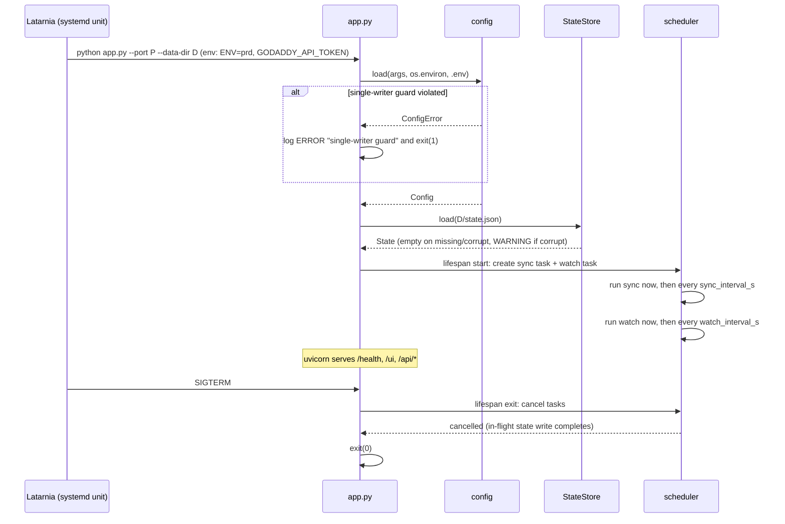
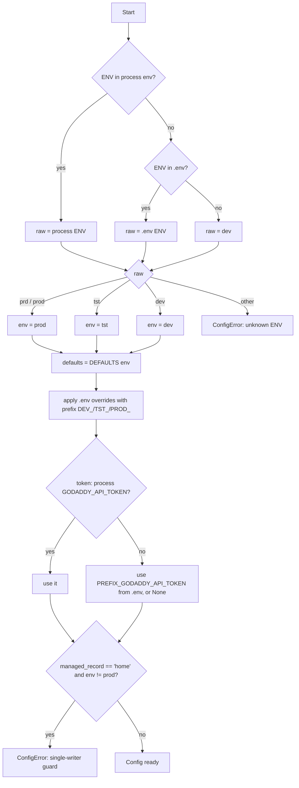
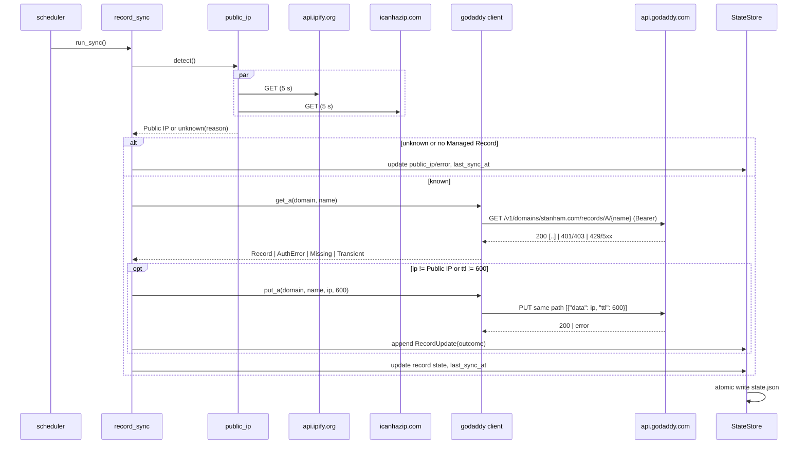
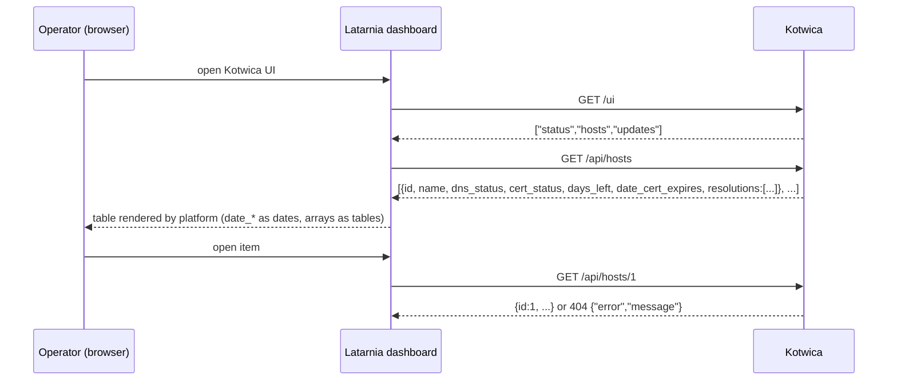
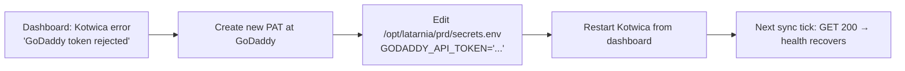

# P-0001 Workflows — Kotwica

The diagrams reference capabilities (`cap-XXX`) and key flows (`flow-XX`) from [spec.md](spec.md). Flows 01–04 are in the spec; this file adds the startup, config, and component-level detail.

## W-1 — Startup and shutdown [cap-001, cap-002, cap-003]



## W-2 — Config resolution [cap-002]



## W-3 — Sync job internals [cap-004, cap-005, flow-01]



## W-4 — Watch job internals [cap-006, cap-007, flow-02]

```mermaid
sequenceDiagram
    participant J as scheduler
    participant DW as dns_watch
    participant TW as tls_watch
    participant R as resolvers 8.8.8.8 / 1.1.1.1
    participant T as tls_connect_host:port (Caddy)
    participant S as StateStore
    J->>J: for each Watched Host
    J->>DW: check(host, public_ip)
    loop each resolver
        DW->>R: A? host (5 s, direct)
        R-->>DW: answer | NXDOMAIN | timeout
    end
    DW-->>J: dns_status + resolutions
    J->>TW: check(host, port, connect_host)
    TW->>T: TCP connect + TLS (SNI=host, verify, 10 s)
    T-->>TW: cert | verify error | refused/timeout
    TW-->>J: cert_status, not_after, days_left, issuer, error
    J->>S: replace WatchedHostState
    J->>S: last_watch_at = now; atomic write
```

## W-5 — Health evaluation [cap-008, flow-03]

```mermaid
flowchart TD
    A[GET /health] --> B[Read in-memory State + Config + now]
    B --> C[Evaluate Health Rules 1..13 in order]
    C --> D[matches = rules whose condition holds]
    D --> E{matches empty?}
    E -- yes --> F[good: DNS ip ok; certs min_days+ days]
    E -- no --> G[level = worst of matches]
    G --> H[message = first match + ' (+N more)' if N>0]
    H --> I[truncate to 100 chars]
    F & I --> J[extra_info: public_ip, record_ip, last_sync, last_watch, host:port → days_left]
    J --> K[200 JSON]
```

## W-6 — Latarnia UI rendering [cap-009]



## W-7 — Operator: token rotation [cap-005, cap-008]


